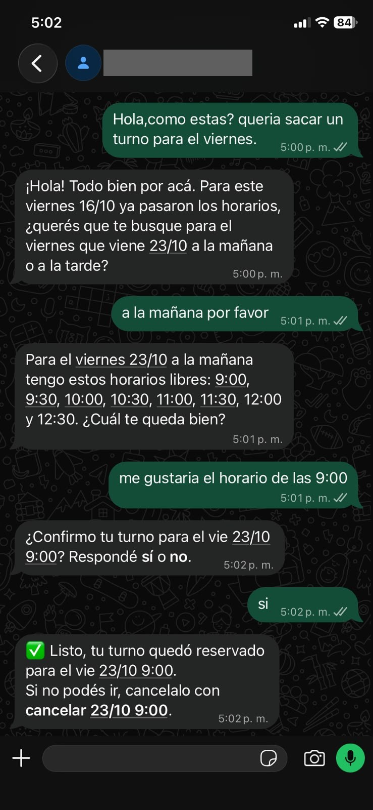
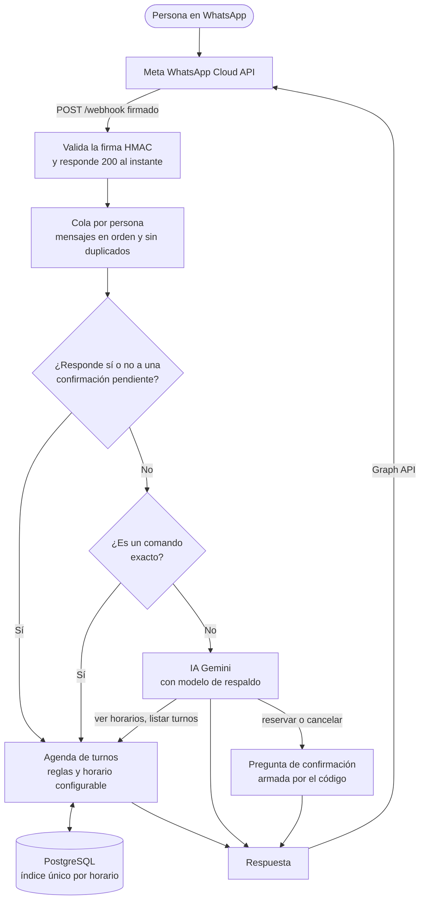

# WhatsApp AI Bot

Bot de WhatsApp que agenda turnos. Entiende comandos (`turno 20/10 10:30`) y frases libres ("quiero un turno el martes a la tarde") con IA, y guarda todo en PostgreSQL.

Stack: NestJS, TypeScript, PostgreSQL con TypeORM, Swagger, Jest, Gemini (opcional). Deploy en Railway.

## Qué tiene

- **Webhook de Meta** con firma HMAC validada, respuesta `200` inmediata y procesamiento en segundo plano. Los mensajes de una misma persona se procesan en orden (cola por contacto) y los reintentos de Meta no duplican respuestas.
- **Agenda de turnos** con horario configurable y un índice único en la base: dos reservas simultáneas del mismo horario no se pisan.
- **IA que propone y el código decide:** reservar y cancelar exigen un "sí" forzado por el código; el modelo nunca elige a quién afecta una acción.
- **Operación:** `/health` que verifica la base, migraciones automáticas, apagado ordenado (termina los mensajes en curso), límite de pedidos por IP y Swagger apagado en producción.
- **Evaluación de la IA** reproducible (`npm run eval:ai`), con 33 casos y un informe por modelo.
- Más de 200 tests en Jest y commits chicos.

## Demo

Conversación real con el bot en producción (WhatsApp, Railway, Gemini). La persona escribe con sus palabras, el bot ofrece horarios reales, **pide confirmación** y recién con el "sí" reserva. El número del bot está tapado.

<p align="center">
  
</p>

## Cómo funciona



La IA solo **propone**: reservar y cancelar quedan pendientes hasta que la persona responda "sí", y esa pregunta la arma el código, no el modelo. Las reglas de horario y el candado contra dobles reservas viven en la agenda y la base, no en el prompt.

## Cómo correrlo

```bash
npm install
cp .env.example .env   # y completá los valores (ver abajo)
docker compose up -d   # levanta PostgreSQL (necesita Docker Desktop abierto)
npm run start:dev      # aplica las migraciones al arrancar
```

PostgreSQL queda en el puerto **5433** para no chocar con un Postgres instalado en tu máquina.

### Migraciones

```bash
npm run migration:generate -- src/database/migrations/NombreDelCambio   # después de cambiar una entidad
npm run migration:run
npm run migration:revert
```

- Swagger: http://localhost:3000/docs
- Tests: `npm test`

## Variables de entorno

| Variable | Qué es |
|---|---|
| `PORT` | Puerto local (3000 por defecto) |
| `WHATSAPP_VERIFY_TOKEN` | Texto que inventás vos; debe coincidir con el del panel de Meta |
| `WHATSAPP_APP_SECRET` | App Secret de tu app de Meta (para validar la firma) |
| `WHATSAPP_TOKEN` | Token de acceso de la Cloud API |
| `WHATSAPP_PHONE_NUMBER_ID` | ID del número de teléfono de prueba/real |
| `WHATSAPP_API_VERSION` | Versión de la Graph API, ej. `v25.0` |
| `DB_HOST`, `DB_PORT`, `DB_USER`, `DB_PASSWORD`, `DB_NAME` | Conexión a PostgreSQL (los de `.env.example` sirven para Docker local) |

Nunca subas el `.env` (está en `.gitignore`).

## Endpoints

- `GET /webhook`: verificación de Meta (`hub.mode`, `hub.verify_token`, `hub.challenge`).
- `POST /webhook`: recibe mensajes. Valida `X-Hub-Signature-256` con HMAC-SHA256 y responde un eco.

## Probarlo con un túnel local

1. Levantá el bot: `npm run start:dev`.
2. Abrí un túnel al puerto 3000, por ejemplo con ngrok: `ngrok http 3000` (o `cloudflared tunnel --url http://localhost:3000`). Copiá la URL `https://...`.
3. En [developers.facebook.com](https://developers.facebook.com) > tu app > WhatsApp > Configuración:
   - Callback URL: `https://TU-URL/webhook`
   - Verify token: el mismo valor de `WHATSAPP_VERIFY_TOKEN`
   - Tocá **Verificar y guardar** y suscribite al campo `messages`.
4. Completá el `.env` (App Secret en Configuración > Básica; token y phone number ID en WhatsApp > Configuración de la API) y reiniciá el bot.
5. Desde tu celular (agregado como número de prueba) mandá un mensaje al número de prueba: el bot responde `Eco: <tu mensaje>`.

## Agenda de turnos

Horario: lunes a viernes, 9:00 a 18:00, turnos de 30 minutos, hora de Argentina (UTC-3). Se cambia en `src/appointments/schedule.ts`.

| Escribís | Qué hace |
|---|---|
| `ayuda` | Muestra los comandos |
| `disponibles` | Próximos horarios libres |
| `disponibles 20/10` | Horarios libres de un día (también `hoy` y `mañana`) |
| `turno 20/10 10:30` | Reserva |
| `mis turnos` | Lista tus turnos |
| `cancelar 20/10 10:30` | Cancela un turno |

Un horario no puede tener dos turnos activos: lo garantiza un índice único en la base (solo cuenta los turnos no cancelados), así que dos reservas simultáneas no se pisan.

## IA con Gemini (opcional)

Si escribís algo que no es un comando ("quiero un turno el martes a la tarde"), lo interpreta Gemini. Sin `GEMINI_API_KEY` la IA queda apagada y el bot sigue andando con los comandos.

Cómo está pensado:

- **Los comandos exactos no usan IA:** son gratis, instantáneos y sin ambigüedad.
- **La IA propone, el código decide:** el modelo solo tiene 4 herramientas (ver horarios, pedir reserva, ver mis turnos, pedir cancelación). Todas pasan por las mismas reglas de `AppointmentsService`.
- **Reservar y cancelar piden confirmación forzada por el código:** el bot guarda la acción 10 minutos y solo la ejecuta con un "sí" exacto. La pregunta de confirmación la arma el código, no el modelo.
- **El modelo nunca elige a quién afecta una acción:** todo se hace sobre el contacto que escribe.
- **Límites:** 500 caracteres de entrada, 20 consultas por persona por día (`AI_DAILY_LIMIT`) y 4 vueltas máximas al modelo. Si la IA falla, responde como sin ella.
- **Modelo de respaldo:** si el principal falla (saturado, sin cuota) o no contesta en 12 s, la consulta se repite **desde cero** con el de respaldo (20 s). No se le pasan datos internos del primero, que no son intercambiables entre modelos.
- **La confirmación se guarda recién al preguntar:** una reserva pedida por el modelo queda pendiente solo cuando la persona recibe la pregunta "¿Confirmo…?". Si la IA falla a mitad de camino, no queda nada que un "sí" suelto pueda ejecutar.
- **Proveedor intercambiable:** el resto de la app usa la interfaz `LlmProvider` (`src/ai/llm.types.ts`); Gemini es un adaptador (`src/ai/gemini.provider.ts`).

Variables: `GEMINI_API_KEY` (gratis en aistudio.google.com/apikey), `AI_MODEL`, `AI_FALLBACK_MODEL` (`none` lo desactiva), `AI_PRIMARY_TIMEOUT_MS`, `AI_TIMEOUT_MS`, `AI_THINKING_LEVEL` y `AI_DAILY_LIMIT`.

> En el plan gratis de Gemini, Google puede usar lo que se le envía para mejorar sus productos. Al modelo solo le llegan frases sobre turnos, nunca teléfonos. Los modelos disponibles gratis y sus límites cambian: se ven en Google AI Studio.

## Horario configurable

Todo el horario sale de variables de entorno (valores por defecto entre paréntesis). Si alguna es inválida, la app **no arranca** y dice qué corregir.

| Variable | Qué es |
|---|---|
| `BUSINESS_NAME` | Nombre del negocio, aparece en el saludo (vacío) |
| `SCHEDULE_OPEN` / `SCHEDULE_CLOSE` | Apertura y cierre en `HH:MM` (`09:00` / `18:00`) |
| `SCHEDULE_SLOT_MINUTES` | Duración de cada turno (`30`) |
| `SCHEDULE_DAYS` | Días de atención, `0` = domingo ... `6` = sábado; admite rangos y listas: `1-5`, `1,3,5` (`1-5`) |
| `SCHEDULE_MAX_DAYS_AHEAD` | Hasta cuántos días adelante se puede reservar (`60`) |

La ayuda, los errores y el prompt de la IA describen siempre el horario vigente. Ejemplo para otro negocio: `SCHEDULE_DAYS=6 SCHEDULE_OPEN=10:00 SCHEDULE_CLOSE=12:00 SCHEDULE_SLOT_MINUTES=40`.

## Seguridad y límites

- **Firma de Meta** validada con HMAC-SHA256 (`timingSafeEqual`) sobre el cuerpo crudo.
- **Límite de pedidos por IP:** 10 por minuto en la verificación del webhook (acepta el token por URL, así que frena los intentos a ciegas) y 300 por minuto en el resto. Detrás de Railway se usa la IP real (`trust proxy`).
- **Swagger** (`/docs`) está activo en desarrollo y apagado en producción; `SWAGGER_ENABLED=true` lo publica (por ejemplo, para mostrarlo en un portfolio).
- **Secretos** solo en variables de entorno; el `.env` no se sube.

## Evaluación de la IA

`npm run eval:ai` corre 33 conversaciones contra Gemini y mide el **estado final**, no el texto: qué quedó pendiente y qué herramientas usó. Cada caso corre con las reglas reales de turnos, una base en memoria y una fecha fija (jueves 15/10/2026 12:00), así que los resultados son comparables entre modelos. Distingue los errores del modelo de los fallos del proveedor (saturación, cuota) y los reintenta.

```bash
npm run eval:ai                                   # usa AI_MODEL del .env
npm run eval:ai -- --models gemini-3.5-flash-lite,gemini-3.8-flash --write
npm run eval:ai -- --only res-lunes-10,seg-tema --delay 5000
```

`--write` guarda un informe por modelo en `docs/evals/`. Gasta cuota real del plan gratis de Gemini (unas 2 a 3 llamadas por caso); como comparte el proyecto con el bot en producción, conviene correrlo de a poco.

## Deploy en Railway

1. Subí el repo a GitHub y en [railway.app](https://railway.com) creá un proyecto con **Deploy from GitHub repo**.
2. En el mismo proyecto agregá una base: **New > Database > PostgreSQL**.
3. En el servicio del bot, pestaña **Variables**:
   - `DATABASE_URL` = `${{Postgres.DATABASE_URL}}` (referencia a la base; sin SSL porque es red interna)
   - `WHATSAPP_VERIFY_TOKEN`, `WHATSAPP_APP_SECRET`, `WHATSAPP_TOKEN`, `WHATSAPP_PHONE_NUMBER_ID`, `WHATSAPP_API_VERSION`
4. **Settings > Networking > Generate Domain** y usá `https://TU-DOMINIO/webhook` como URL en Meta.
5. El chequeo de salud es `/health` y las migraciones se aplican solas al arrancar (ver `railway.json`).

## Problemas comunes con Meta

- **El bot no recibe mensajes reales (el botón "Probar" sí funciona):** la cuenta de WhatsApp tiene que estar suscrita a tu app. Se hace con `POST /{WABA_ID}/subscribed_apps` en la Graph API.
- **Error 131030 "not in allowed list" con un número argentino:** Meta entrega `549...` pero la lista de destinatarios guarda `54...`. El bot ya le saca el 9 (`src/whatsapp/normalize-phone.ts`).
- **Error 190 "Authentication Error":** el token temporal dura 24 hs. Generá uno nuevo en WhatsApp > Configuración de la API.
- **Dejó de llegar todo:** el túnel gratis de Cloudflare se cayó o cambió de URL. Levantá uno nuevo y cargá la URL en Meta (Configurar webhooks).
